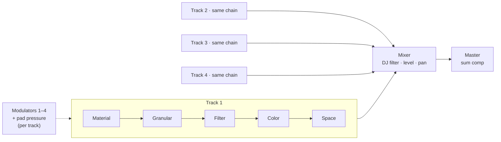

# 03 · Architecture

I'm keeping the S-4's shape exactly: four parallel stereo tracks, each a fixed five-device chain, summed through a mixer with a per-channel DJ filter and a compressor on the master bus.

## Tracks

Each track's **Material** sets what the track is:

| Material mode | Behavior |
| --- | --- |
| Tape | A loop recorder with overdub, start/length/speed |
| Poly | An 8-voice sampler played from Keys mode or MIDI |
| Live | Processes the audio input in real time |
| Off | The track passes nothing; its chain still rings out tails |

## Modulation

- 4 modulators per track: LFO, Random, Envelope, Follower.
- Any parameter on any page can be a destination, with unlimited destinations per modulator.
- **Pad pressure is a fifth source.** Action pads and Perform macros route aftertouch to their targets, and Keys mode routes per-voice aftertouch.

The one structural addition over the S-4 is that pressure source. Everything else is the S-4's shape, so the mental model carries straight over.

## Voice and CPU budget

The MPC Sample has 32 stereo voices. Four tracks × 8 poly voices uses all 32 in the worst case, before any granular grain cost is counted.

My plan:

1. A **shared voice pool** with a per-track cap, set in Mix → Master.
2. A **CPU meter** in the status bar on every screen, so the cost of a change is visible right away.
3. A **grain cap per track** if 4 × 128 grains won't fit. I'll pick the real numbers after profiling on hardware.

Battery operation makes this matter more than it would on wall power. A patch that drains the battery in an hour is a bug.
