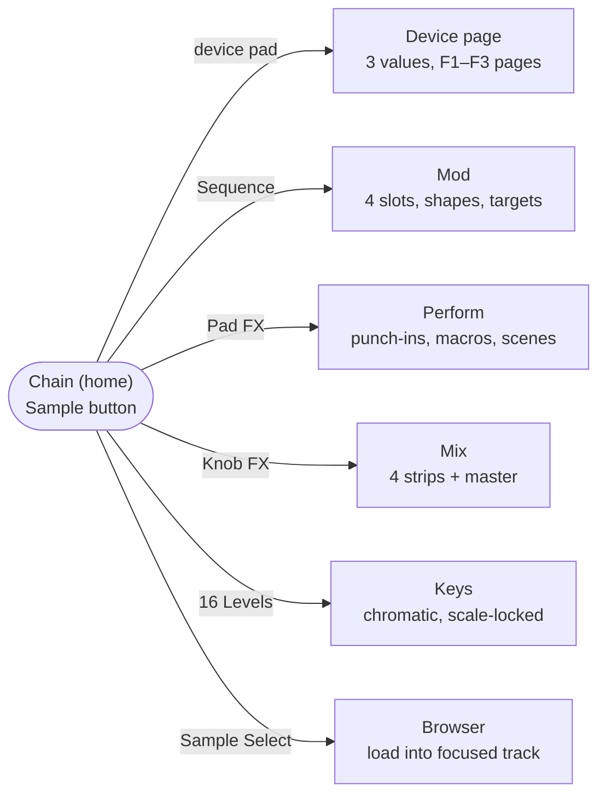

# 06 · Screens

Navigation is a hub and spokes. Chain is home, every other screen is one press away and one press back, and nothing nests deeper than device → page.

Press the active mode's button again to return to Chain. Hold Shift anywhere to draw the pad legend overlay.

## The four zones

Every screen shares the same layout, so your eyes always know where to look. Sizes assume a 320 × 240 panel.

| Zone | Height | Contents |
| --- | --- | --- |
| **Status bar** | 22 px | Track glyph and number, breadcrumbs (track · device · page), tempo, CPU, battery |
| **F-button labels** | 24 px | Three page names directly above F1–F3; the active one gets an underline in the track color |
| **Visual** | ~114 px | The device's picture. It's context only, so nothing in it is required to operate the device. |
| **Value row** | 80 px | Three values with arcs and the knob-position tick, lined up over knobs 1–3 |

Type minimums: value numerals 20 px, labels 11 px, contrast 7:1 (see [Accessibility](08-accessibility.md)).

## Per-screen contents

| Screen | F1 / F2 / F3 | Visual | Values (F1 page) |
| --- | --- | --- | --- |
| Chain | Tracks / Scenes / Project | 4 lanes × 5 device blocks; solid = editing, dashed = bypassed | Level · Pan · DJ filter (focused track) |
| Material | Tape / Play / Env | Waveform with loop region and playhead | Start · Length · Speed |
| Granular | Grain / Spray / Pitch | Grain cloud: dots over the 4 s buffer, size = grain size | Size · Density · Contour |
| Filter | Tone / Bank / Mode | 48 bars, one per resonator band | Cutoff · Resonance · Morph |
| Color | Drive / Crush / Glue | Transfer curve that bends with drive | Low drive · High drive · Crossover |
| Space | Room / Delay / Blend | Decay envelope with delay taps | Size · Decay · Damping |
| Mod | Shape / Timing / Targets | Waveform plus a target list with signed depths | Rate · Depth · Phase |
| Perform | Macros / Scenes / Map | 8 macro bars, latched badges, A → B morph strip | Macro depth · Scene · Morph |
| Mix | Strip / Input / Master | 4 meters with text badges (SEL, MUTE, SOLO) | Level · Pan · DJ filter (selected strip) |
| Large mode | Same as the device | One arc, one huge value, page dots | One value at a time |

## Chain home detail

The Chain screen swaps the visual zone for four lanes, one per track. Each lane shows its five devices as small blocks:

- **Solid, track color**: the device being edited.
- **Dark track tint**: active.
- **Dashed outline, dim label**: bypassed.

That's the same three-tier language as the pads, so the screen and the grid always agree.

## Design references

The walkthrough site's screens section renders Chain, Granular, Filter and Large mode at scale. Its source is on the `gh-pages` branch in `assets/app.js` (the `screen()` function), which is the closest thing to a reference renderer right now.
